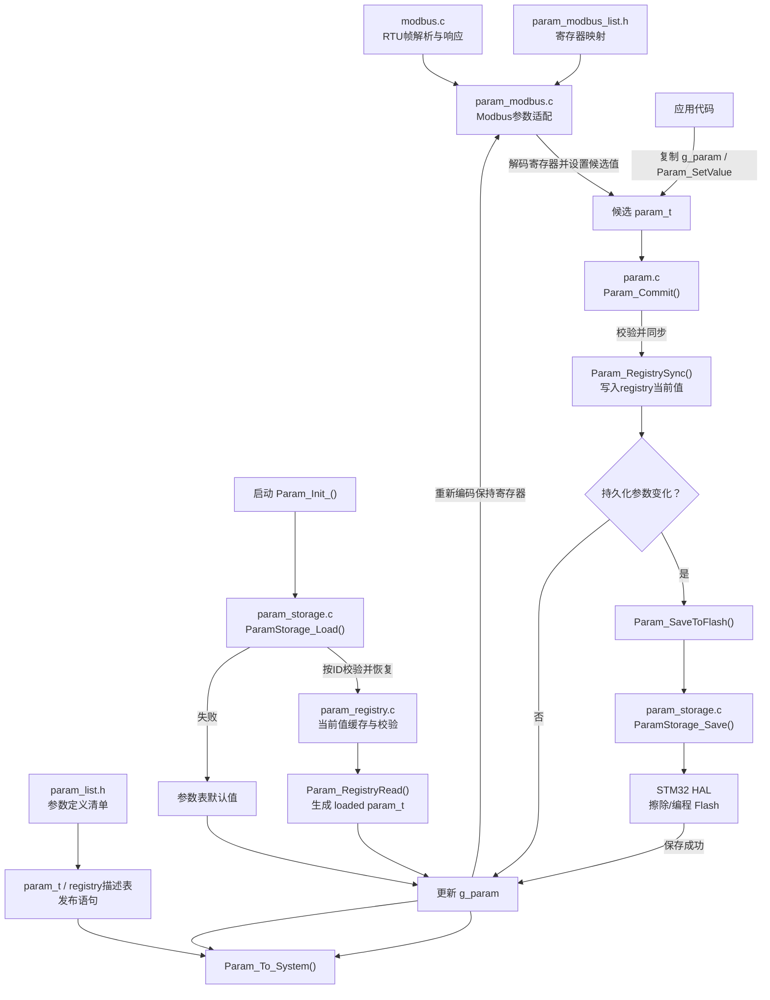

# 参数管理使用说明

本文说明应用代码如何初始化、读取、修改和提交参数，以及如何新增参数和配置 Modbus 映射。参数定义以 `param_list.h` 为准，公开接口声明见 `param.h`。

## 代码层级与调用流程

下图展示启动加载与运行时写入的主要调用关系。参数服务负责候选值、提交和发布；registry 负责按 ID 校验并缓存当前值；storage 负责 Flash 快照；Modbus 层负责把寄存器值转换成参数值。



简化理解：**参数清单定义参数，参数服务管理提交，registry 按 ID 校验和暂存，storage 读写 Flash，通信适配层负责协议格式转换。**启动时从 Flash 恢复到 registry，再生成运行态；运行时写入则从候选状态提交到 registry，并在需要时保存 Flash，成功后更新运行态和发布目标。

## 1. 启动初始化

在控制任务开始使用参数之前调用一次 `Param_Init_()`：

```c
uint8_t status = Param_Init_();
```

- 返回 `0`：从 Flash 加载成功，或当前有效参数已准备好。
- 返回 `1`：加载/初始化过程遇到问题，参数服务已回退到定义表默认值。

初始化完成后，当前参数可从 `g_param` 读取；参数表中配置了发布语句的字段也已同步到对应运行模块。即使返回 `1`，也应检查并记录状态，但参数值会使用默认值继续运行。

如果需要在运行中主动恢复默认值，可调用 `Param_InitDefault()`。该函数会重建 `g_param` 并同步 registry；若要让 PID 等目标模块也立即更新，再调用 `Param_To_System(&g_param)`。

## 2. 读取参数

优先使用参数 ID 读取，避免业务代码依赖字段布局：

```c
double kp;

if (Param_GetValue(&g_param, PARAM_ID_KP_SPEED, &kp))
{
    /* 使用 kp */
}
```

`Param_GetValue()` 成功返回非零，失败返回 `0`。也可以直接读取 `g_param.kp`；直接访问适合明确知道字段的内部代码，跨模块接口建议使用稳定 ID。

## 3. 修改并提交参数

修改时先复制当前状态，在副本上逐项设置，最后统一提交：

```c
param_t candidate = g_param;

if (!Param_SetValue(&candidate, PARAM_ID_KP_SPEED, 0.65))
{
    /* ID 不存在、无写权限、类型不合适或超出范围 */
}
else if (!Param_Commit(&candidate))
{
    /* registry 同步或必要的 Flash 保存失败 */
}
```

`Param_SetValue()` 和 `Param_Commit()` 成功返回非零。`Param_SetValue()` 会检查参数 ID、写权限、类型和范围，只修改传入的状态副本。`Param_Commit()` 会统一校验并同步参数；持久化参数发生变化时保存 Flash。只有提交成功后，`g_param` 和系统发布目标才会更新。

不要直接修改 `g_param` 后假设参数已经提交：直接写字段会绕过 `Param_SetValue()` 的校验、Flash 保存和系统发布。`Param_Sanitize()` 目前只检查指针和 registry 初始化状态，不代替逐项数值校验。

一次修改多个参数时，把多个 `Param_SetValue()` 调用放在同一个候选副本上，最后只调用一次 `Param_Commit()`。任一设置失败就丢弃该副本，不提交部分结果。

## 4. 参数何时写入 Flash

只有定义中带 `PARAM_ACCESS_PERSIST` 的参数会持久化。`Param_Commit()` 只在这类参数的值发生变化时写入新快照；只修改非持久化参数不会触发 Flash 写入。

参数加载按稳定 ID 匹配 Flash 记录。新增参数没有旧记录时使用默认值；固件删除的参数被忽略；类型或长度不匹配、当前权限不允许、旧值超出当前范围时，只跳过对应记录。整份快照 CRC 损坏时才会拒绝该快照并继续查找其他有效快照。

已经发布的参数 ID 应保持不变，不能因为参数顺序调整而重编号。如果参数含义发生变化，应分配新 ID 或编写显式迁移；仅修改字段名不会改变存储 ID。

常规应用代码应通过 `Param_Commit()` 保存。`Param_SaveToFlash()` 保存的是 registry 当前值，只有确认 registry 已同步到期望状态时才直接调用它。

## 5. 新增参数

在 `param_list.h` 的 `PARAM_LIST(X)` 中增加一行：

```c
X(PARAM_ID_LIMIT, 0x0105u,
  PARAM_TYPE_FLOAT,
  PARAM_ACCESS_READ | PARAM_ACCESS_WRITE | PARAM_ACCESS_PERSIST,
  0.0, 10.0, 2.0f,
  float, limit, )
```

字段顺序为：

```text
X(符号名, 稳定ID, registry类型, 权限, 最小值, 最大值, 默认值,
  C字段类型, param_t字段名, 可选发布语句)
```

参数表会自动生成 ID 枚举、`param_t` 字段和 registry 描述项。发布语句可留空；若需要把值发布给其他模块，在这一栏填写有效 C 语句，例如：

```c
g_speed_pid.Proportion = state->kp;
```

发布语句在 `Param_To_System()` 中展开，可使用 `state`。目标变量需要在 `param.c` 可见（包含对应头文件或声明 `extern`）。没有发布目标的参数保持为空，不需要额外修改发布函数。

类型建议保持对应：`PARAM_TYPE_FLOAT` 配 `float`，`PARAM_TYPE_INT32` 配 `int32_t`，`PARAM_TYPE_UINT32` 配 `uint32_t`。ID 必须唯一且稳定，范围和默认值必须符合字段类型。

## 6. 添加 Modbus 映射

只有需要经 Modbus 访问的参数才需修改 `param_modbus_list.h`。每行格式为：

```c
X(零基保持寄存器偏移, 参数ID, 缩放倍数, 线上类型)
```

例如，浮点参数 `0.65` 若使用缩放 `10000.0`，线上寄存器值为 `6500`。有符号目标速度使用 `PARAM_MODBUS_S16`；非负增益使用 `PARAM_MODBUS_U16`。寄存器偏移必须唯一、处于 `HOLDING_REG_NUM` 范围，并确保缩放后值适合对应的 16 位类型。

Modbus 读请求会先把当前参数编码到保持寄存器镜像；单寄存器写和多寄存器写会先校验，再提交参数。多寄存器请求中的映射参数作为一批处理，参数校验通过后统一提交。未映射的保持寄存器仍属于 Modbus 寄存器镜像，不会成为参数。

## 7. 主要接口速查

| 接口 | 用途 | 成功返回 |
|---|---|---:|
| `Param_Init_()` | 启动时加载 Flash 并发布最终参数 | `0` 表示正常加载；`1` 表示回退默认值 |
| `Param_GetValue(state, id, &value)` | 按 ID 读取参数 | 非零 |
| `Param_SetValue(state, id, value)` | 校验并修改候选状态 | 非零 |
| `Param_Commit(&candidate)` | 提交候选状态，按需持久化并发布 | 非零 |
| `Param_InitDefault()` | 把 `g_param` 和 registry 恢复为默认值 | `void` |
| `Param_To_System(&state)` | 执行参数表中的发布语句 | `void` |
| `Param_LoadFromFlash(&state)` | 加载 Flash 并生成 `param_t` 状态 | `0` |
| `Param_SaveToFlash()` | 保存 registry 当前值快照 | 非零 |
| `Param_ApplyEx(start, count, &exception)` | 应用保持寄存器区间并返回异常码 | 非零 |

`Param_ApplyEx()` 的异常码：`0x02` 表示地址非法，`0x03` 表示数据非法，`0x04` 表示提交或存储故障。Modbus 协议处理通常由 `modbus.c` 调用，应用层一般使用 `Param_SetValue()` 与 `Param_Commit()`。

## 8. 相关文件

| 文件 | 作用 |
|---|---|
| `param_list.h` | 参数 ID、字段、权限、范围、默认值和发布语句 |
| `param_modbus_list.h` | 参数到 Modbus 保持寄存器的映射 |
| `param.h` | 参数服务公开接口及 `param_t` 定义 |
| `param.c` | 运行态、提交、启动恢复和系统发布 |
| `param_registry.c/.h` | 参数描述、按 ID 校验和类型化当前值缓存 |
| `param_modbus.c` | Modbus 参数编码、解码和批量应用 |
| `param_storage.c` | Flash 快照加载、保存及扇区轮换 |

更多快照布局、RAM 估算和当前实现限制见同目录的 `README.md`。
